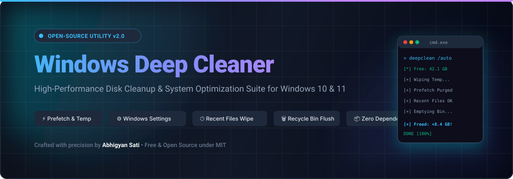

<div align="center">

  

  <br />

  <p align="center">
    <strong>A high-performance, open-source disk cleanup and system optimization suite for Windows 10 & 11.</strong>
    <br />
    <em>Safely reclaims gigabytes of disk space, eliminates obsolete caches, and optimizes system responsiveness with zero third-party bloat.</em>
  </p>

  <p align="center">
    <a href="https://github.com/a4ik7/windows-deep-cleaner/actions"></a>
    <a href="LICENSE"></a>
    <a href="https://github.com/a4ik7/windows-deep-cleaner/stargazers"></a>
    <a href="https://github.com/a4ik7/windows-deep-cleaner/network/members"></a>
    <a href="https://github.com/a4ik7/windows-deep-cleaner/issues"></a>
    
  </p>

  <p align="center">
    <a href="#-quick-start">Quick Start</a> •
    <a href="#-key-features">Features</a> •
    <a href="#-cli-usage--switches">CLI Switches</a> •
    <a href="docs/CLEANUP_MATRIX.md">Cleanup Matrix</a> •
    <a href="docs/BENCHMARKS.md">Benchmarks</a> •
    <a href="docs/FAQ.md">FAQ</a> •
    <a href="#-author--acknowledgements">Author</a>
  </p>

</div>

---

## ⚡ Overview

Over time, Windows accumulates tens of gigabytes in obsolete temporary installers, stale prefetch records, outdated GPU shader caches, Windows Update deployment leftovers, and unemptied recycle bins across secondary drives. 

**Windows Deep Cleaner (WDC)** is an enterprise-grade, lightweight, dependency-free utility written in native Batch and PowerShell. It safely purges disposable system waste without touching personal user documents, browsers passwords, or system integrity.

### 🌟 Why Windows Deep Cleaner?

| Feature | Windows Deep Cleaner (WDC) | Native Disk Cleanup (`cleanmgr`) | Commercial Cleaners |
| :--- | :---: | :---: | :---: |
| **Prefetch & ReadyBoot Purge** | ✅ **Yes** | ❌ No | ⚠️ Paywalled |
| **Windows Settings Temp UI Integration** | ✅ **Yes (Direct)** | ❌ No | ❌ No |
| **DirectX / NVIDIA / AMD Shader Caches** | ✅ **Yes** | ❌ No | ❌ Rare |
| **Recent History & JumpLists Cleared** | ✅ **Yes** | ❌ No | ⚠️ Partial |
| **All-Drive Recycle Bin Purge** | ✅ **Yes** | ⚠️ Current drive only | ⚠️ Premium |
| **Real-Time Space Freed Calculator** | ✅ **Yes (Live GB count)** | ❌ No | ⚠️ Bloated |
| **Telemetry, Ads & Upselling** | 🛡️ **Zero (100% Free & Open Source)** | 🛡️ Zero | ❌ Heavy Ads & Tracking |
| **Zero Installation Required** | 🚀 **Portable Script** | Portable | ❌ Needs Installer |

---

## ✨ Key Features

- 🧹 **User & System Temp**: Deeply purges `%temp%` and `C:\Windows\Temp` including deeply nested cache subtrees.
- ⚡ **Windows Prefetch Purge & Inspector**: Safely wipes obsolete application startup traces (`*.pf`) and ReadyBoot caches while offering an instant visual Explorer inspector.
- ⚙️ **Windows Settings Temporary Files Integration**: Launches the native Windows 10/11 **Storage Sense & Temporary Files** panel (`ms-settings:storagesettings`) and triggers the multi-cache background cleanup engine (`cleanmgr /sagerun:64`).
- 🕒 **File Explorer Recent Files & JumpLists**: Wipes recent file shortcuts, `AutomaticDestinations`, and `CustomDestinations` for complete privacy.
- 🎮 **DirectX & GPU Shader Caches**: Clears DirectX, NVIDIA (`DXCache`), and AMD Radeon shader caches—fixing stuttering in modern games and freeing 5–20 GB.
- 📦 **Windows Update & Delivery Optimization**: Safely halts update services, removes cached update installers in `SoftwareDistribution\Download`, and flushes P2P delivery chunks.
- 🗑️ **All-Drive Recycle Bin Obliteration**: Empties Recycle Bins across all mounted internal drives and external storage devices permanently.
- 🌐 **DNS Resolver Flush**: Flushes the local DNS client resolver cache to repair stale connections and resolve DNS routing bottlenecks.
- 📊 **Real-Time Space Benchmarking**: Automatically records disk capacity before and after execution, displaying exact gigabytes reclaimed.

---

## 🖥️ Interactive Console Interface

```text
 ==============================================================================
     __        ___           _                     ____                      
     \ \      / (_)_ __   __| | _____      _____  |  _ \  ___  ___ _ __      
      \ \ /\ / /| | '_ \ / _` |/ _ \ \ /\ / / __| | | | |/ _ \/ _ \ '_ \     
       \ V  V / | | | | | (_| | (_) \ V  V /\__ \ | |_| |  __/  __/ |_) |    
        \_/\_/  |_|_| |_|\__,_|\___/ \_/\_/ |___/ |____/ \___|\___| .__/     
                           C L E A N E R                       |_|          
 ==============================================================================
   Professional System Disk Optimization Engine  |  Developed by Abhigyan Sati
 ==============================================================================

   [i] Current Free Space on System Drive (C:): 97.41 GB

   Choose an operating mode:

   [1] Automated Deep Clean (Recommended)
       - Rapidly purges Temp, Prefetch, Shaders, Updates, Recent & Recycle Bin.

   [2] Visual Deep Clean (Interactive Mode)
       - Opens Prefetch folder & Windows Settings Temp Files UI while cleaning.

   [3] Open Cleaners & System Locations
       - Opens Prefetch, Temp, Recent history & Windows Storage Settings UI.

   [4] Selective Custom Cleanup
       - Choose specifically which caches or history directories to wipe.

   [5] Exit
 ==============================================================================
   Select option [1-5] (Auto-running Option 1 in 15s):
```

---

## 🚀 Quick Start

### Method 1: Instant One-Liner (PowerShell)
Open PowerShell as Administrator and run:
```powershell
irm https://raw.githubusercontent.com/a4ik7/windows-deep-cleaner/main/deepclean.bat -OutFile deepclean.bat; .\deepclean.bat
```

### Method 2: Git Clone
```bash
# Clone the repository
git clone https://github.com/a4ik7/windows-deep-cleaner.git

# Enter the directory
cd windows-deep-cleaner

# Run the cleaner (will auto-prompt for Administrator if needed)
deepclean.bat
```

### Method 3: Direct Download
1. Download [`deepclean.bat`](https://raw.githubusercontent.com/a4ik7/windows-deep-cleaner/main/deepclean.bat).
2. Right-click the downloaded file and select **Run as administrator**.

---

## 🕹️ CLI Usage & Command-Line Switches

Windows Deep Cleaner can be seamlessly integrated into automated maintenance scripts, deployment pipelines, or Windows Task Scheduler using CLI flags:

| Switch | Description | Example |
| :--- | :--- | :--- |
| *(None)* | Launches the interactive dashboard with 15s countdown | `deepclean.bat` |
| `/auto` or `-y` | Runs unattended 1-click total system deep clean | `deepclean.bat /auto` |
| `/visual` | Opens Prefetch in Explorer and launches Windows Storage Settings GUI while cleaning | `deepclean.bat /visual` |
| `/open` | Direct inspector launcher to open Prefetch, Temp, Recent & Settings folders | `deepclean.bat /open` |
| `/silent` | Headless execution without any interactive prompts (ideal for Task Scheduler) | `deepclean.bat /silent` |
| `/help` or `-h` | Displays the built-in CLI help manual | `deepclean.bat /help` |
| `/version` or `-v` | Prints current version and author credits | `deepclean.bat /version` |

---

## 📁 Repository Structure

```text
windows-deep-cleaner/
├── .github/
│   ├── ISSUE_TEMPLATE/
│   │   ├── bug_report.yml          # Structured GitHub bug report issue form
│   │   ├── feature_request.yml     # Feature proposal form
│   │   └── config.yml              # Discussions link configuration
│   ├── workflows/
│   │   └── lint.yml                # CI automation checking script syntax on push
│   └── PULL_REQUEST_TEMPLATE.md    # PR submission checklist
├── assets/
│   └── banner.svg                  # High-resolution vector project banner
├── docs/
│   ├── BENCHMARKS.md               # Real-world test benchmarks across PC setups
│   ├── CLEANUP_MATRIX.md           # Deep dive into every cleaned file path & registry key
│   └── FAQ.md                      # Answers to common user questions & safety details
├── src/
│   ├── deepclean.bat               # Modular batch source code
│   └── DeepClean.ps1               # Modern PowerShell companion edition
├── CHANGELOG.md                    # Detailed version history (Keep a Changelog)
├── CODE_OF_CONDUCT.md              # Contributor Covenant v2.1
├── CONTRIBUTING.md                 # Open-source contribution guide
├── LICENSE                         # Permissive MIT License
├── README.md                       # Comprehensive project documentation
└── deepclean.bat                   # Standalone root distribution script
```

---

## 🛡️ Safety & Security Guarantee

1. **Zero Personal Data Risk**: This script **never** touches `C:\Users\<User>\Documents`, `Desktop`, `Pictures`, `Videos`, or `Downloads` (unless explicitly selected in custom mode).
2. **Graceful Locked-File Handling**: Transient files locked by running applications (e.g. active web browser sessions) are safely bypassed without hanging or terminating processes.
3. **Open & Auditable**: Every single line of code is open-source, human-readable, and free from obfuscation.

For technical details on every directory targeted, see the [Cleanup Matrix](docs/CLEANUP_MATRIX.md).

---

## 📈 Benchmarks

| System Type | Average Space Freed | Average Time |
| :--- | :---: | :---: |
| **Developer Workstation** (Visual Studio, Docker, Node) | **20 – 35 GB** | 12 sec |
| **Gaming Rig** (Steam, Epic, DirectX Shader Caches) | **10 – 25 GB** | 9 sec |
| **Daily Productivity Laptop** (Chrome, Office, Teams) | **5 – 15 GB** | 8 sec |

*See full benchmark methodology in [BENCHMARKS.md](docs/BENCHMARKS.md).*

---

## 🤝 Contributing

Contributions make the open-source community a thriving environment for learning and building! Any contributions you make are **greatly appreciated**.

1. Fork the Project
2. Create your Feature Branch (`git checkout -b feature/NewCacheTarget`)
3. Commit your Changes (`git commit -m 'Add new shader cache target'`)
4. Push to the Branch (`git push origin feature/NewCacheTarget`)
5. Open a Pull Request

Please review [CONTRIBUTING.md](CONTRIBUTING.md) before submitting a PR.

---

## 👤 Author & Acknowledgements

**Windows Deep Cleaner** is maintained and created with passion by:

- **Abhigyan Sati**
  - GitHub: [@a4ik7](https://github.com/a4ik7)
  - Project Link: [https://github.com/a4ik7/windows-deep-cleaner](https://github.com/a4ik7/windows-deep-cleaner)

---

## ⭐ Support the Project

If Windows Deep Cleaner helped speed up your machine or reclaimed precious gigabytes on your SSD:
- Give this repository a **Star** ⭐ on GitHub!
- Share it with fellow developers, sysadmins, and gamers on Reddit, Twitter, and Discord.
- Report any bugs or submit improvements via Pull Requests.

---

## 📄 License

Distributed under the **MIT License**. See [`LICENSE`](LICENSE) for more details.
