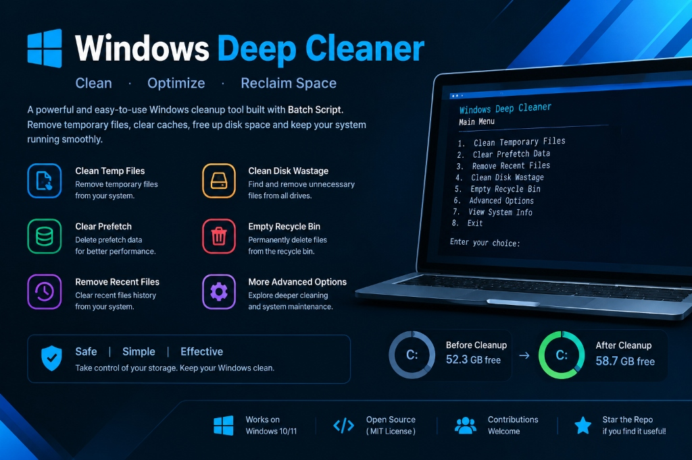

<div align="center">

  

  <br />

  <p align="center">
    <strong>A native, dependency-free Windows disk cleanup and forensic artifact hygiene engine.</strong>
    <br />
    <em>Purges deep system caches, prefetch traces, JumpLists, shader caches, and update leftovers using built-in Windows utilities.</em>
  </p>

  <p align="center">
    <a href="https://github.com/a4ik7/windows-deep-cleaner/actions"></a>
    <a href="LICENSE"></a>
    <a href="https://github.com/a4ik7/windows-deep-cleaner/stargazers"></a>
    <a href="https://github.com/a4ik7/windows-deep-cleaner/network/members"></a>
    
    
  </p>

  <p align="center">
    <a href="#-quick-start">Quick Start</a> •
    <a href="#-technical-coverage">Coverage</a> •
    <a href="#-cli-flags">CLI Flags</a> •
    <a href="docs/CLEANUP_MATRIX.md">Internals Matrix</a> •
    <a href="docs/BENCHMARKS.md">Benchmarks</a> •
    <a href="docs/FAQ.md">FAQ</a> •
    <a href="#-author">Author</a>
  </p>

</div>

---

## ⚡ Overview

Windows Deep Cleaner is a lightweight Windows cleanup tool built with Batch scripting. 🧹

With just one click, it helps remove temporary files, clear selected caches, clean recent-file history, and free up disk space.

⚡ Simple to use. No extra software required.

---

## 🔍 Technical Coverage

WDC targets specific system layers that default Windows tools ignore or hide behind multi-layer menus:

| Target Category | Filesystem / Registry Location | Systems & Forensic Rationale |
| :--- | :--- | :--- |
| **Prefetch & ReadyBoot** | `%SystemRoot%\Prefetch\*.pf` | Purges application execution trace hashes and ReadyBoot caches. Windows cleanly regenerates traces for active apps. |
| **Explorer JumpLists** | `%AppData%\Microsoft\Windows\Recent\AutomaticDestinations`<br>`%AppData%\Microsoft\Windows\Recent\CustomDestinations` | Removes OLE structured storage databases tracking opened documents, recents, and pinned taskbar history. |
| **Recent File Activity** | `%AppData%\Microsoft\Windows\Recent\*.*` | Clears Explorer LNK shortcuts tracking user file activity. |
| **DirectX / GPU Shaders** | `%LocalAppData%\D3DSCache`<br>`%LocalAppData%\NVIDIA\DXCache`<br>`%LocalAppData%\AMD\DxCache` | Purges compiled GPU driver shader blobs. Resolves micro-stutters and frees 5–20 GB on gaming and rendering workstations. |
| **Crash Dumps & WER** | `%LocalAppData%\CrashDumps`<br>`%ProgramData%\Microsoft\Windows\WER` | Deletes application user-mode crash dumps (`.dmp`) and diagnostic reports that can retain process memory fragments. |
| **Windows Update Payloads** | `%SystemRoot%\SoftwareDistribution\Download`<br>`%SystemRoot%\SoftwareDistribution\DeliveryOptimization` | Safely stops `wuauserv` and `bits` to remove applied `.cab`/`.msu` update leftovers and LAN P2P delivery cache. |
| **User & System Temp** | `%temp%`<br>`%SystemRoot%\Temp` | Recursively cleans scratch directories while safely skipping handles locked by running applications. |
| **VolumeCaches Engine** | `HKLM\...\Explorer\VolumeCaches` (`cleanmgr /sagerun:64`) | Automates 20 native Windows low-level volume cache flags for system-managed background compression and cleanup. |
| **Storage Settings GUI** | `ms-settings:storagesettings` | Directly invokes Windows 10/11 native Storage Sense temporary file analyzer for interactive inspection. |
| **Recycle Bin (All Volumes)** | `$Recycle.Bin` across all logical drives | Empties recycle bins across internal and external partitions via native PowerShell API. |
| **DNS Resolver** | `ipconfig /flushdns` | Flushes DNS cache to clear stale lookups and poisoned resolution records. |

---

## 🚀 Quick Start

### Option 1: 1-Click Run via PowerShell (Admin)
```powershell
irm https://raw.githubusercontent.com/a4ik7/windows-deep-cleaner/main/deepclean.bat -OutFile deepclean.bat; .\deepclean.bat
```

### Option 2: Clone & Inspect
```bash
git clone https://github.com/a4ik7/windows-deep-cleaner.git
cd windows-deep-cleaner
deepclean.bat
```

> **Note**: Administrative elevation is required to access system directories (`C:\Windows\Prefetch`, `C:\Windows\SoftwareDistribution`). The script automatically prompts for elevation and preserves all passed arguments.

---

## 🕹️ CLI Flags

WDC supports non-interactive execution for automated maintenance scripts and Windows Task Scheduler:

```text
Usage: deepclean.bat [FLAG]

  (None)      Launch the interactive dashboard with auto-run countdown
  /auto, -y   Execute full automated cleanup without interactive prompts
  /visual     Open Explorer at Prefetch and launch Windows Storage Settings during clean
  /open       Launch directory inspectors (Prefetch, Temp, Recent, Storage Sense)
  /silent     Headless execution with zero terminal output (ideal for scheduled tasks)
  /help, -h   Display CLI reference
  /version    Print version and author details
```

### Scheduled Task Example
To run WDC automatically every Sunday at midnight without UI interruption:
```powershell
schtasks /create /tn "WindowsDeepClean" /tr "C:\path\to\deepclean.bat /silent" /sc weekly /d SUN /st 00:00 /rl highest
```

---

## 📊 Benchmarks

Measured on standard Windows 10 and 11 environments:

```
+------------------------------------+------------------+----------------+
| Machine Type                       | Avg Space Freed  | Avg Execution  |
+------------------------------------+------------------+----------------+
| Developer Box (VS, Docker, npm)    | 18 - 32 GB       | ~11 seconds    |
| Gaming Rig (NVIDIA/AMD Shaders)    | 10 - 24 GB       | ~8 seconds     |
| Daily Productivity Laptop          | 4 - 12 GB        | ~6 seconds     |
+------------------------------------+------------------+----------------+
```

*Detailed methodology and directory breakdowns are documented in [BENCHMARKS.md](docs/BENCHMARKS.md).*

---

## 📁 Repository Structure

```text
windows-deep-cleaner/
├── .github/
│   ├── ISSUE_TEMPLATE/
│   │   ├── bug_report.yml          # Structured GitHub bug reporting form
│   │   ├── feature_request.yml     # Feature proposal form
│   │   └── config.yml              # Community links
│   └── workflows/
│       └── lint.yml                # CI syntax validation for batch & PowerShell
├── assets/
│   └── banner.svg                  # SVG project banner
├── docs/
│   ├── BENCHMARKS.md               # Storage reclamation benchmarks
│   ├── CLEANUP_MATRIX.md           # Technical directory & registry matrix
│   └── FAQ.md                      # Safety details & operational FAQ
├── src/
│   ├── deepclean.bat               # Modular batch implementation
│   └── DeepClean.ps1               # PowerShell companion edition
├── CHANGELOG.md                    # Version history following Keep a Changelog
├── CONTRIBUTING.md                 # Contribution guidelines
├── LICENSE                         # MIT License
├── README.md                       # Repository documentation
├── deepclean.bat                   # Standalone 1-click executable
└── push.ps1                        # 1-click automated GitHub sync script
```

---

## 🛡️ Operational Safety

1. **No Personal Data Impact**: Targets transient OS caches only. Never touches `%USERPROFILE%\Documents`, `Desktop`, `Pictures`, `Videos`, or `Downloads`.
2. **Process Lock Handling**: Files currently open by running applications (e.g., active browser profiles) are safely skipped (`>nul 2>&1`), preventing process interruption.
3. **Transparent Codebase**: Written in plain, uncompiled batch and PowerShell. Every command is auditable before execution.

---

## 👤 Author

Developed by **Abhigyan Sati**  
- GitHub: [@a4ik7](https://github.com/a4ik7)  
- Focus: Cybersecurity, Red Teaming & Windows Internals  

---

## 📄 License

This project is licensed under the [MIT License](LICENSE).
