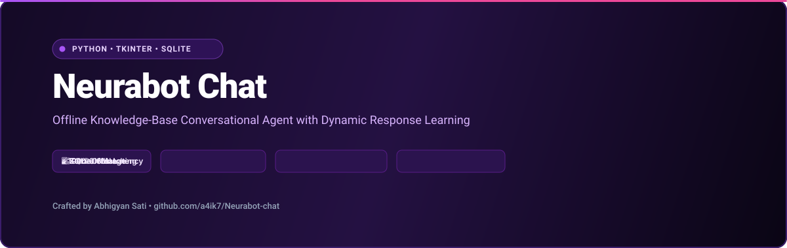

<div align="center">

  

  <br />

  <p align="center">
    <strong>A 100% offline, privacy-first conversational chatbot built with Python standard library &amp; SQLite.</strong>
    <br />
    <em>Fast difflib similarity matching with zero cloud latency, zero external API keys, and persistent local learning.</em>
  </p>

  <p align="center">
    
    
    
    
    <a href="https://github.com/a4ik7/Neurabot-chat/stargazers"></a>
  </p>

</div>

---

## ⚡ Overview

Unlike modern LLMs that require continuous internet connectivity, high-latency API keys, and privacy trade-offs, **NeuraBot** is an offline, deterministic conversational agent. 

It pairs an SQLite relational database with Python’s native sequence similarity algorithms (`difflib`) to deliver instant, local responses with zero cloud exposure.

---

## 🧠 How It Works

1. **Persistent Knowledge Base**: All question-response pairs and category tags reside inside a local SQLite database (`chatbot_memory.db`).
2. **Fuzzy String Matching**: User prompts are evaluated against known entries using Gestalt Pattern Matching via `difflib.SequenceMatcher`.
3. **Dynamic Popularity Weighting**: Frequently chosen responses gain confidence scores, allowing the agent to refine prioritization over time.
4. **Interactive Teaching Interface**: Users can inject new knowledge entries dynamically during chat without restarting the application.

---

## 🚀 Quick Setup

```bash
# Clone the repository
git clone https://github.com/a4ik7/Neurabot-chat.git
cd Neurabot-chat

# Install dependencies (if any external packages listed)
pip install -r requirements.txt

# Run the chatbot interface
python app.py
```

---

## 💡 Teaching NeuraBot in Real-Time

In the chat interface, teach new responses instantly using the `learn:` directive:

```text
learn: <pattern or question> | <response text>
```

**Example:**
```text
learn: what is the function of windows prefetch? | Prefetch caches application startup traces to speed up binary initialization.
```

---

## 👤 Author

Developed by **Abhigyan Sati**  
- GitHub: [@a4ik7](https://github.com/a4ik7)  
- Focus: Python Automation & Cybersecurity  
